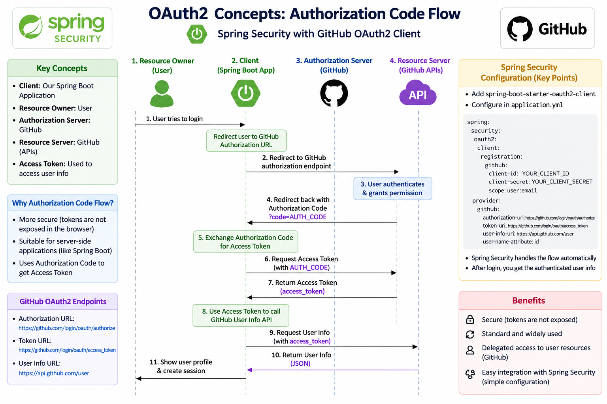
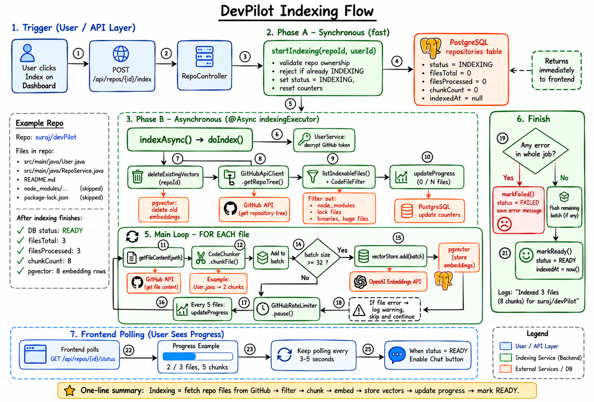
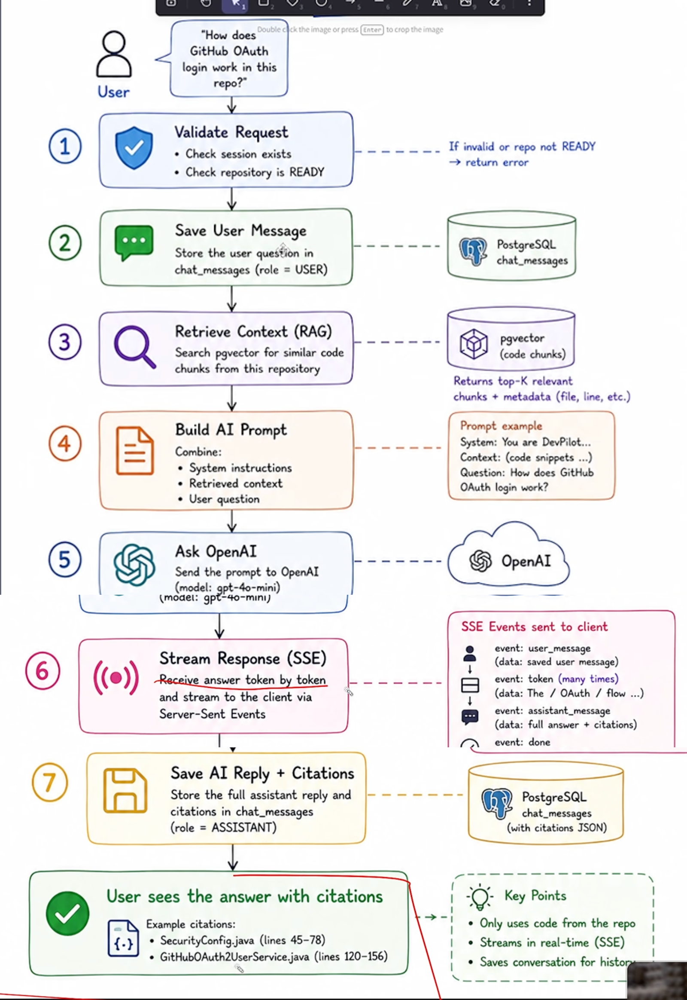

# RepoMind

**Chat with your GitHub code.**

RepoMind lets you sign in with GitHub, pick one of your repositories, and ask questions about its code in plain English, for example:

- "Where is the login logic?"
- "How does the indexing work?"
- "Which file talks to the database?"

The AI answers using **your actual code** and shows which files the answer came from.

---

## Table of contents

1. [What this project does](#what-this-project-does)
2. [How it works (the simple version)](#how-it-works-the-simple-version)
3. [Tech stack](#tech-stack)
4. [Project structure](#project-structure)
5. [The full flow, step by step](#the-full-flow-step-by-step)
6. [Database tables](#database-tables)
7. [API endpoints](#api-endpoints)
8. [How to run it locally](#how-to-run-it-locally)
9. [Settings you can change](#settings-you-can-change)
10. [Words you might not know](#words-you-might-not-know)

---

## What this project does

1. **Log in with GitHub.** No passwords. You click "Sign in with GitHub" and you're in.
2. **See your repositories.** The app fetches every repo you own or can access on GitHub.
3. **Index a repository.** You click "Index" on a repo. The app downloads its code files, cuts them into small pieces, and saves those pieces in a special database that can search by *meaning*, not just by exact words.
4. **Chat with it.** Ask a question. The app finds the code pieces most related to your question, sends them to an AI model along with your question, and streams the answer back to you word by word.
5. **See sources.** Each answer comes with "citation chips" that show which files were used.
6. **Keep history.** Your chats are saved, so you can come back to them later.

---

## How it works (the simple version)

Think of it like this:

> You give a librarian (the AI) a huge book (your repo). The librarian can't read the whole book every time you ask something.
> So first we **cut the book into small pages** and file them in a smart cabinet that groups pages by topic (**indexing**).
> When you ask a question, we **pull out the 8 pages most related to your question** (**retrieval**) and hand only those to the librarian, who then writes an answer (**generation**).

This pattern is called **RAG (Retrieval-Augmented Generation)**.

```
┌──────────────┐      ┌──────────────────────┐      ┌───────────────────────┐
│   Browser    │ ───► │  Frontend (Next.js)  │ ───► │  Backend (Spring Boot)│
│   (you)      │ ◄─── │  localhost:3000      │ ◄─── │  localhost:8080       │
└──────────────┘      └──────────────────────┘      └───────────┬───────────┘
                                                               │
                         ┌─────────────────────────────────────┼──────────────────────────┐
                         │                                     │                          │
                         ▼                                     ▼                          ▼
               ┌───────────────────┐            ┌──────────────────────────┐   ┌────────────────────┐
               │   GitHub API      │            │ PostgreSQL + pgvector    │   │  DeepSeek AI       │
               │ (login, repos,    │            │ (users, repos, chats,    │   │  (writes answers)  │
               │  file contents)   │            │  code "embeddings")      │   │                    │
               └───────────────────┘            └──────────────────────────┘   └────────────────────┘
```

---

## Tech stack

### Frontend (`client/` folder) — what you see in the browser

| Tool | What it's used for |
|---|---|
| **Next.js 16** (App Router) | The web framework: pages, routing, page protection |
| **React 19** | Building the UI |
| **TypeScript** | JavaScript with types, to catch mistakes early |
| **Tailwind CSS 4** | Styling |
| **shadcn/ui + Base UI** | Ready-made UI components (buttons, cards, sidebar, dialogs…) |
| **TanStack React Query** | Fetching data from the backend, caching it, and auto-refreshing indexing progress |
| **Streamdown** | Showing the AI's markdown answer (with code highlighting) while it's still streaming in |
| **next-themes** | Light / dark mode |
| **lucide-react, react-icons** | Icons |
| **Recharts** | Charts on the overview dashboard |

### Backend (`backend/` folder) — the server that does the real work

| Tool | What it's used for |
|---|---|
| **Java 21** | Programming language |
| **Spring Boot 4** | The server framework |
| **Spring Web MVC** | REST API endpoints + streaming (SSE) |
| **Spring Security + OAuth2 Client** | "Log in with GitHub" and protecting the API |
| **Spring Data JPA (Hibernate)** | Saving and reading data from PostgreSQL |
| **Spring AI** | Talking to the AI model, creating embeddings, and using the vector database |
| **DeepSeek** (`deepseek-chat`) | The AI model that writes the answers (called through its OpenAI-compatible API) |
| **all-MiniLM-L6-v2** (ONNX, runs locally) | Turns text into numbers ("embeddings", 384 numbers each). Runs on your machine, so it's free |
| **Lombok** | Cuts down boilerplate Java code (getters, setters, constructors) |
| **Maven** | Builds the backend and downloads libraries |

### Database & infrastructure

| Tool | What it's used for |
|---|---|
| **PostgreSQL 16** | Main database |
| **pgvector** | PostgreSQL add-on that stores embeddings and finds "similar" ones fast (HNSW index, cosine distance) |
| **Docker Compose** | Starts the database with one command |

---

## Project structure

```
Project/
├── docker-compose.yml          # Starts PostgreSQL + pgvector
├── docker/postgres/
│   └── init-extensions.sql     # Turns on the vector, hstore and uuid extensions
├── .env.example                # Example of the secrets file you need to create
│
├── backend/                    # Spring Boot server (Java)
│   ├── pom.xml                 # Backend dependencies
│   └── src/main/
│       ├── resources/application.properties   # All backend settings
│       └── java/project/backend/
│           ├── BackendApplication.java        # Starting point of the server
│           ├── config/        # Security, CORS, token encryption, background thread pool
│           ├── controllers/   # API endpoints (Auth, Repo, Chat)
│           ├── dto/           # Shapes of data sent to / received from the frontend
│           ├── entity/        # Database tables as Java classes (User, Repository, ChatSession, ChatMessage)
│           ├── repository/    # Database queries
│           ├── security/      # GitHub login handling, "who is the current user"
│           ├── exceptions/    # Error types + one place that turns errors into nice JSON
│           └── services/
│               ├── UserService.java    # Saves GitHub users, encrypts/decrypts their GitHub token
│               ├── RepoService.java    # Syncs repos from GitHub
│               ├── ChatService.java    # Chat sessions + the main "ask a question" flow
│               ├── github/             # GitHub API client + small delay to avoid rate limits
│               ├── indexing/           # Picks which files to index, cuts them into chunks, stores them
│               └── ai/                 # Finds relevant code, builds the prompt, streams the AI answer
│
└── client/                     # Next.js frontend (TypeScript)
    ├── proxy.ts                # Redirects to /login if you're not signed in
    ├── app/                    # Pages
    │   ├── page.tsx                    # Landing page
    │   ├── login/                      # Sign-in page
    │   ├── auth/callback/              # Where GitHub sends you back after login
    │   ├── dashboard/                  # Repository list
    │   ├── dashboard/overview/         # Stats (repos, ready to chat, chunks, failures)
    │   ├── dashboard/settings/         # Account settings
    │   └── chat/[repoId]/              # Chat screen for one repo
    ├── components/
    │   ├── chat/               # Chat window, message list, input box, citations, sidebar
    │   ├── dashboard/          # Repo cards, status badges, overview, settings
    │   ├── layout/             # App shell (sidebar + header)
    │   ├── providers/          # React Query, theme, "must be logged in" wrapper
    │   └── ui/                 # Generic shadcn UI building blocks
    ├── hooks/                  # use-auth, use-repo, use-chat (data fetching logic)
    └── lib/
        ├── api.ts              # All calls to the backend + shared types
        └── stream-chat.ts      # Reads the live (streamed) AI answer
```

---

## The full flow, step by step

### 1. Logging in

```
You click "Sign in with GitHub"
   → browser goes to backend: /oauth2/authorization/github
   → backend sends you to GitHub's login/approve page
   → you approve (permissions: read your profile + read your repos)
   → GitHub sends you back to the backend with a code
   → backend swaps the code for a GitHub access token
   → backend saves/updates you in the "users" table
       (the GitHub token is ENCRYPTED before it is saved)
   → backend creates a session cookie (DEVPILOT_SESSION, lasts 7 days)
   → backend redirects you to the frontend: /auth/callback
   → frontend confirms who you are (/api/auth/me) and sends you to /dashboard
```

Code: `SecurityConfig.java`, `GithubOAuth2UserService.java`, `UserService.java`, `client/app/auth/callback/page.tsx`.

This is the standard OAuth2 "Authorization Code" flow, and Spring Security handles almost all of it for us:



### 2. Loading your repositories

```
Dashboard opens
   → frontend calls GET /api/repos
   → backend uses your GitHub token to fetch all your repos (up to 1,000)
   → each repo is saved/updated in the "repositories" table
   → the list is shown as cards with language, private/public and index status
```

Code: `RepoController.java`, `RepoService.java`, `GithubApiClient.java`.

### 3. Indexing a repository (turning code into searchable pieces)

```
You click "Index"
   → POST /api/repos/{id}/index
   → backend marks the repo as INDEXING and replies right away (202 Accepted)
   → the real work runs in the BACKGROUND (separate thread pool), so the page doesn't freeze:

      a. Delete any old pieces for this repo (in case you re-index)
      b. Ask GitHub for the full file list of the default branch
      c. Keep only useful files:
           ✔ code / config / docs files (.java, .ts, .py, .md, .yml, Dockerfile, …)
           ✘ skip node_modules, .git, dist, build, target, .next, vendor, etc.
           ✘ skip lock files (package-lock.json, yarn.lock, …)
           ✘ skip hidden files and files bigger than 100 KB
      d. For each file:
           - download its content from GitHub
           - cut it into chunks of about 200 tokens (~800 characters)
           - each chunk gets a label: repoId, file path, language, chunk number
      e. Every 32 chunks: turn them into embeddings (lists of 384 numbers that
         capture the "meaning") and save them in pgvector
      f. Every 5 files: update progress (files done / total, chunks so far)
      g. Wait 50 ms between files so GitHub doesn't block us

   → when finished: status = READY (or FAILED with an error message)

Meanwhile the frontend asks GET /api/repos/{id}/status every few seconds
and shows a live progress bar.
```

Code: `IndexingService.java`, `CodeFileFilter.java`, `CodeChunker.java`, `GitHubRateLimiter.java`, `AppConfig.java`.

The full indexing flow as a diagram:



> Note: the diagram shows the "OpenAI Embeddings API", but the code now uses the **local all-MiniLM-L6-v2 model** for embeddings, so no external service is called for this step.

### 4. Chatting with a repository

```
You open a READY repo and start a chat
   → POST /api/chat/sessions  (creates a "chat session", e.g. "Chat with owner/repo")

You type a question and press send
   → POST /api/chat/sessions/{id}/messages
   → backend:
      1. Checks the session is yours and the repo is READY
      2. Saves your question in the database
      3. RETRIEVE: turns your question into an embedding and asks pgvector
         for the 8 most similar code chunks — ONLY from this repo
      4. BUILD PROMPT:
           - System prompt: "You are RepoMind, an expert on <repo>.
             Answer ONLY from the provided code. If unsure, say so.
             Cite file paths. Be concise."
           - User prompt: the 8 code chunks + your question
      5. GENERATE: sends the prompt to DeepSeek and streams the answer back
         using Server-Sent Events (SSE). Events sent to the browser:
           user_message      → your saved question
           token             → each small piece of the answer, as it is written
           assistant_message → the final full answer + citations (saved in the DB)
           done              → finished
   → frontend shows the answer appearing live, rendered as markdown,
     with clickable file chips underneath
```

Code: `ChatController.java`, `ChatService.java`, `services/ai/*`, `client/lib/stream-chat.ts`, `client/components/chat/*`.

The full chat (RAG) flow as a diagram:



> Note: the diagram shows OpenAI (`gpt-4o-mini`), but the code now uses **DeepSeek (`deepseek-chat`)** to write the answers. The steps are exactly the same.

### 5. Logging out

`POST /api/auth/logout` → the session is destroyed and the cookie is deleted.

---

## Database tables

All tables are created automatically when the backend starts (`ddl-auto=update`).

| Table | What it stores |
|---|---|
| `users` | Your GitHub id, username, display name, avatar, and your **encrypted** GitHub token |
| `repositories` | Repos synced from GitHub + indexing status (`PENDING` / `INDEXING` / `READY` / `FAILED`), file counts, chunk count, error message |
| `chat_sessions` | One row per conversation (which user, which repo, title) |
| `chat_messages` | Every question (`USER`) and answer (`ASSISTANT`), plus citations for answers |
| `vector_store` | Created by Spring AI. Every code chunk, its 384-number embedding, and its labels (repoId, filePath, language) |

---

## API endpoints

Everything under `/api/**` requires you to be logged in (except `/api/auth/login-url`).

| Method | URL | What it does |
|---|---|---|
| GET | `/api/auth/login-url` | Returns the GitHub login URL |
| GET | `/api/auth/me` | Returns the logged-in user |
| POST | `/api/auth/logout` | Logs out |
| GET | `/api/repos?refresh=true` | Lists your repos (`refresh=true` re-syncs from GitHub first) |
| GET | `/api/repos/{id}` | One repo's details |
| GET | `/api/repos/{id}/status` | Indexing progress |
| POST | `/api/repos/{id}/index` | Starts (re-)indexing in the background |
| POST | `/api/chat/sessions` | Creates a chat session (`{ repositoryId, title? }`) |
| GET | `/api/chat/sessions?repositoryId=…` | Lists chat sessions for a repo |
| GET | `/api/chat/sessions/{id}` | All messages in a session |
| POST | `/api/chat/sessions/{id}/messages` | Sends a question; the answer is **streamed** back (SSE) |

---

## How to run it locally

### What you need installed

- **Docker** (for the database)
- **Java 21**
- **Node.js 20+** and npm
- A **GitHub OAuth App** ([create one here](https://github.com/settings/developers))
  - Homepage URL: `http://localhost:3000`
  - Authorization callback URL: `http://localhost:8080/login/oauth2/code/github`
- A **DeepSeek API key** ([platform.deepseek.com](https://platform.deepseek.com))

### Step 1 — Create the `.env` file

In the project root, create a file called `.env`:

```env
POSTGRES_PASSWORD=pick-any-password
DEEPSEEK_API_KEY=your-deepseek-key
GITHUB_CLIENT_ID=your-github-oauth-client-id
GITHUB_CLIENT_SECRET=your-github-oauth-client-secret

# Optional (have defaults, but change these for anything beyond local dev)
# TOKEN_ENCRYPTOR_PASSWORD=some-long-random-string
# TOKEN_ENCRYPTOR_SALT=a-hex-string-like-deadbeefcafebabe
# FRONTEND_URL=http://localhost:3000
# CORS_ALLOWED_ORIGINS=http://localhost:3000
```

> ⚠️ Never commit `.env`. It is already in `.gitignore`.

### Step 2 — Start the database

```bash
docker compose up -d
```

This starts PostgreSQL with pgvector on **port 5433** (database name: `devpilot`).

### Step 3 — Start the backend

The backend reads its secrets from environment variables, so load `.env` first:

```bash
cd backend
set -a; source ../.env; set +a
./mvnw spring-boot:run
```

(In VS Code you can also use the **BackendApplication** launch config — it loads `.env` for you.)

The backend runs on **http://localhost:8080**.
The first start may take a bit longer because the local embedding model is downloaded.

### Step 4 — Start the frontend

```bash
cd client
npm install
npm run dev
```

The frontend runs on **http://localhost:3000**. Open it, sign in with GitHub, index a repo, and start chatting.

> If your backend is not on `http://localhost:8080`, set `NEXT_PUBLIC_API_BASE_URL` in `client/.env.local`.

---

## Settings you can change

In `backend/src/main/resources/application.properties`:

| Setting | Default | Meaning |
|---|---|---|
| `app.indexing.max-file-bytes` | `102400` (100 KB) | Files bigger than this are skipped |
| `app.indexing.chunk-size` | `800` | Rough size of each code piece, in characters |
| `app.github.api-delay-ms` | `50` | Pause between GitHub calls while indexing |
| `spring.ai.openai.chat.options.model` | `deepseek-chat` | Which AI model writes the answers |

In `backend/.../services/ai/RagSettings.java`:

| Setting | Default | Meaning |
|---|---|---|
| `TOP_K_CHUNKS` | `8` | How many code pieces are given to the AI per question |
| `STREAM_TIMEOUT_MS` | `180000` (3 min) | Max time an answer can take to stream |

---

## Words you might not know

| Word | Simple meaning |
|---|---|
| **Repository (repo)** | A project folder on GitHub |
| **OAuth** | "Log in with X" — lets the app use your GitHub account without seeing your password |
| **Indexing** | Preparing the code so it can be searched quickly |
| **Chunk** | A small piece of a file |
| **Embedding** | A list of numbers that represents the *meaning* of some text. Similar meaning → similar numbers |
| **Vector database (pgvector)** | A database that can find the embeddings closest to a given one, i.e. "find code that means something similar to my question" |
| **RAG** | Retrieval-Augmented Generation: first *find* relevant info, then let the AI *write* an answer using it |
| **LLM** | Large Language Model — the AI that writes text (here: DeepSeek) |
| **Prompt** | The text/instructions we send to the AI |
| **SSE (Server-Sent Events)** | A way for the server to keep sending small updates to the browser, which is how the answer appears word by word |
| **Citation** | A pointer to the file the answer came from |
